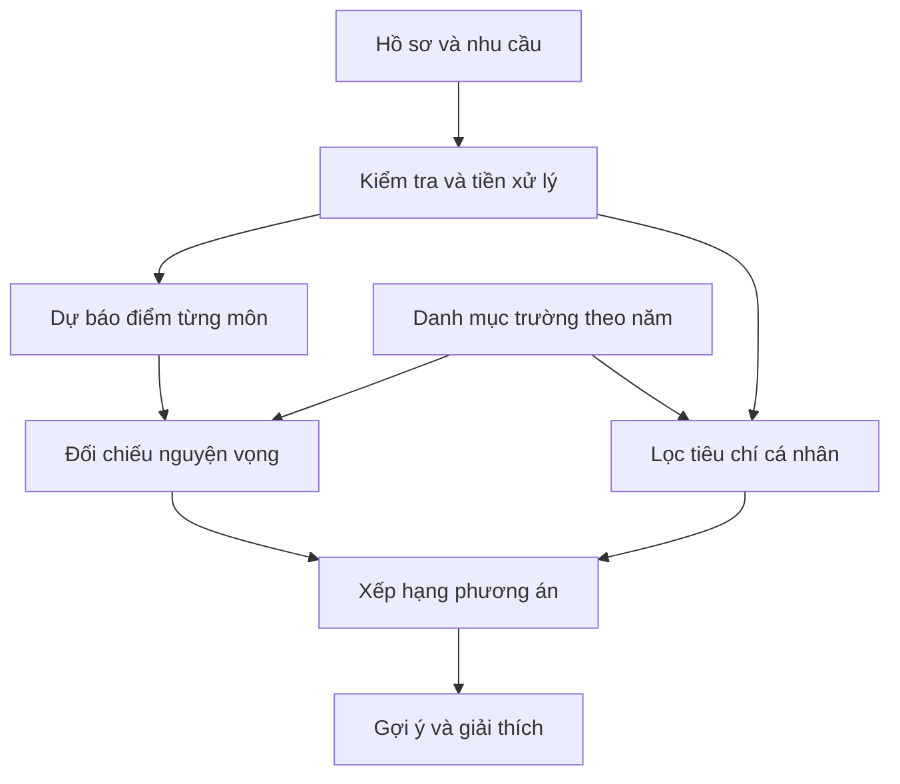

# MÔ TẢ DỰ ÁN NGHIÊN CỨU KHOA HỌC

**Chủ đề:** Hệ thống dự báo điểm và hỗ trợ lựa chọn trường phù hợp cho học sinh sau trung học cơ sở.

**Tên đề tài đề xuất:** Hệ thống hỗ trợ lựa chọn trường THPT cho học sinh lớp 9 dựa trên dự báo điểm thi bằng CatBoost và SVR kết hợp các tiêu chí cá nhân.

**Tên tiếng Anh đề xuất:** A Decision Support System for Grade 9 Students’ High School Selection Using CatBoost and Support Vector Regression with Personal Criteria.

**Phiên bản tài liệu:** 1.0 — ngày 21/10/2026.

**Trạng thái:** Bản mô tả định hướng nghiên cứu và kế hoạch thực hiện. Chưa phải bài báo hoàn chỉnh, chưa có kết quả huấn luyện hoặc kiểm chứng trên dữ liệu thực tế.

> Quy ước: “Đã có” chỉ thông tin được xác nhận từ trao đổi và tài liệu dữ liệu hiện tại. “Đề xuất” là phương án để nhóm triển khai, chưa phải quyết định chính thức hoặc kết quả đã đạt được.

## 1. Tóm tắt dự án

Dự án hướng đến xây dựng một hệ thống hỗ trợ học sinh cuối cấp THCS cân nhắc nguyện vọng học tập dựa trên năng lực học tập, sở thích, ngân sách và khoảng cách di chuyển. Ý tưởng ban đầu bao gồm lựa chọn trường và chuyên ngành; trong phiên bản nghiên cứu đầu tiên, phạm vi được đề xuất là học sinh lớp 9 lựa chọn trường THPT và nhóm môn định hướng.

Hệ thống được chia thành ba phần: dự báo điểm thi; đánh giá nguyện vọng theo thông tin có sẵn trước kỳ thi; và gợi ý lựa chọn trường dựa trên nhiều tiêu chí. Hai họ thuật toán được nhóm quan tâm là CatBoost và SVM. Trong bài toán dự báo điểm liên tục, biến thể phù hợp của họ SVM là SVR — Support Vector Regression. Nếu triển khai phân loại kết quả tuyển sinh, có thể nghiên cứu thêm CatBoostClassifier và SVC.

Dữ liệu hiện tại là bộ mô phỏng 50.000 hồ sơ, mở rộng từ 10.000 hồ sơ gốc. Mục đích trước mắt là thử quy trình, so sánh mô hình và phát triển nguyên mẫu. Những kết luận trên dữ liệu này cần giới hạn trong điều kiện mô phỏng, không diễn giải thành khả năng tư vấn tuyển sinh đáng tin cậy ngoài thực tế.

## 2. Thông tin đã xác nhận và phần còn đề xuất

| Nội dung | Trạng thái | Diễn giải |
|---|---|---|
| Mục đích viết bài báo nghiên cứu khoa học | Đã xác nhận | Nhóm muốn phát triển ý tưởng thành nghiên cứu có thực nghiệm |
| Đối tượng ban đầu | Đã xác nhận | Học sinh cấp 2 cần cân nhắc lựa chọn học tập |
| Các tiêu chí quan tâm | Đã xác nhận | Điểm số, sở thích, học phí và khả năng đáp ứng nguyện vọng |
| Hai họ thuật toán quan tâm | Đã xác nhận | CatBoost và SVM |
| Bộ dữ liệu gốc | Đã có | 10.000 hồ sơ, 60 cột, dữ liệu giả định |
| Bộ dữ liệu mở rộng | Đã có | 50.000 hồ sơ, 131 cột, vẫn là dữ liệu mô phỏng |
| Dự báo điểm bằng CatBoostRegressor và SVR | Đề xuất | Hướng so sánh thuật toán chính của nghiên cứu |
| Giới hạn vào lớp 9 chọn THPT | Đề xuất theo dữ liệu hiện có | Nhóm cần chốt trước khi đăng ký tên đề tài |
| “Chuyên ngành” chuyển thành nhóm môn định hướng | Đề xuất | Không đồng nhất ngành nghề, lớp chuyên và nhóm môn THPT |
| Địa bàn, trường và quy chế thực tế | Chưa xác định | Bộ hiện tại dùng trường và khu vực hư cấu |
| Mô hình đã huấn luyện, độ chính xác | Chưa có | Không đưa số liệu thành tích vào bài báo trước thực nghiệm |
| Đánh giá của học sinh hoặc chuyên gia | Chưa có | Cần thiết nếu muốn kết luận về chất lượng tư vấn |

## 3. Bối cảnh và vấn đề nghiên cứu

Một lựa chọn trường có thể phù hợp về điểm nhưng chưa phù hợp về học phí, khoảng cách hoặc định hướng học tập. Ngược lại, trường được yêu thích có thể có yêu cầu tuyển sinh vượt năng lực dự kiến. Dự án đặt vấn đề xây dựng một quy trình hỗ trợ cân nhắc đồng thời các yếu tố này.

Các vấn đề nghiên cứu đặt ra gồm:

1. Có thể dự báo điểm thi từ thông tin học tập có trước kỳ thi với mức sai số như thế nào?
2. CatBoost và SVR khác nhau ra sao về sai số, độ ổn định và chi phí tính toán trong cùng điều kiện thực nghiệm?
3. Làm thế nào kết hợp dự báo điểm với các tiêu chí cá nhân để trình bày lựa chọn có lý do rõ ràng?
4. Các kết quả còn giữ được đến đâu khi thay đổi khóa mô phỏng, mức nhiễu hoặc điều kiện sinh dữ liệu?

Đây là các vấn đề nhóm dự kiến kiểm tra. Tài liệu này không khẳng định đã xác định được khoảng trống khoa học hoặc tính mới so với toàn bộ công trình liên quan.

## 4. Mục tiêu nghiên cứu

### 4.1. Mục tiêu tổng quát

Thiết kế và đánh giá một quy trình hỗ trợ lựa chọn trường THPT dựa trên dự báo điểm thi và các tiêu chí cá nhân, thông qua thực nghiệm minh bạch trên dữ liệu mô phỏng, tạo nền tảng cho kiểm chứng bằng dữ liệu thực tế sau này.

### 4.2. Mục tiêu cụ thể

| Mã | Mục tiêu | Bằng chứng cần tạo |
|---|---|---|
| MT01 | Xác định đầu vào, đầu ra và thời điểm dự báo | Đặc tả bài toán và danh sách đặc trưng |
| MT02 | Chuẩn hóa cách sử dụng bộ dữ liệu hiện có | Từ điển dữ liệu, kiểm tra ràng buộc, bảng chia tập |
| MT03 | So sánh CatBoostRegressor với SVR và mô hình mốc | Bảng sai số, thời gian và cấu hình thực nghiệm |
| MT04 | Kiểm tra ảnh hưởng của các nhóm đặc trưng | Thực nghiệm loại bớt/bổ sung đặc trưng |
| MT05 | Thiết kế cơ chế đánh giá nguyện vọng | Công thức, quy tắc và giới hạn diễn giải |
| MT06 | Thiết kế gợi ý trường có ràng buộc cá nhân | Bộ lọc, cách xếp hạng và giải thích đầu ra |
| MT07 | Phân tích khả năng tái lập và giới hạn mô phỏng | Nhật ký thực nghiệm, nguồn dữ liệu, thảo luận hạn chế |

## 5. Câu hỏi nghiên cứu và giả thuyết

### 5.1. Câu hỏi nghiên cứu

| Mã | Câu hỏi | Cách kiểm tra đề xuất |
|---|---|---|
| RQ1 | CatBoost và SVR dự báo điểm ba môn khác nhau như thế nào? | So sánh MAE/RMSE theo môn trên cùng tập test |
| RQ2 | Điểm thi thử có bổ sung thông tin hữu ích so với chỉ dùng lịch sử điểm? | Giữ nguyên thuật toán và quy trình; thay đổi nhóm đầu vào |
| RQ3 | Giờ tự học và chuyên cần mang lại cải thiện đến mức nào? | Thực nghiệm loại bỏ từng nhóm đặc trưng |
| RQ4 | Kết hợp tiêu chí cá nhân thay đổi danh sách gợi ý ra sao? | So sánh xếp hạng chỉ dựa trên điểm với xếp hạng đa tiêu chí |
| RQ5 | Kết quả nhạy đến mức nào với điều kiện mô phỏng và thay đổi khóa? | Đánh giá theo khóa; nếu sinh thêm kịch bản thì kiểm tra nhiễu và quy tắc sinh |

### 5.2. Giả thuyết cần kiểm tra

- **H1:** Ít nhất một mô hình học máy có thể cải thiện sai số so với cách dùng điểm gần nhất làm dự báo.
- **H2:** Bổ sung điểm thi thử giúp giảm sai số trong điều kiện mô phỏng đang xét.
- **H3:** Bổ sung tiêu chí tài chính, khoảng cách và sở thích làm thay đổi mức đáp ứng nhu cầu của danh sách gợi ý.

Các giả thuyết có thể bị bác bỏ. Không mặc định CatBoost tốt hơn SVR hoặc mọi đặc trưng bổ sung đều hữu ích. H3 cần tiêu chí đánh giá độc lập để vượt ra ngoài việc chứng minh hệ thống tuân thủ công thức do nhóm tự đặt.

## 6. Đối tượng và phạm vi

### 6.1. Phạm vi phiên bản đầu tiên đề xuất

- Học sinh lớp 9 có điểm học tập đến thời điểm tư vấn.
- Dự báo điểm Toán, Ngữ văn và Ngoại ngữ của một kỳ thi tuyển sinh mô phỏng.
- Cân nhắc tối đa ba nguyện vọng trong bộ dữ liệu hiện tại.
- Tham khảo bốn nhóm môn: KHTN, KHXH, CONG_NGHE, NGHE_THUAT.
- Tư vấn có xét ngân sách học phí, chi phí trường và khoảng cách một chiều.

### 6.2. Những nội dung chưa thuộc phạm vi kiểm chứng hiện tại

- Tuyển sinh thực tế của một tỉnh/thành cụ thể.
- Đào tạo nghề hoặc dự báo mức phù hợp với chuyên ngành nghề.
- Thi môn chuyên, lớp chuyên, điểm ưu tiên và nhiều phương thức tuyển sinh khác nhau.
- Học bổng, chi phí sinh hoạt hoặc khả năng tài chính dài hạn của gia đình.
- Kết luận về nghề nghiệp tương lai hoặc năng lực cố định của học sinh.
- Khẳng định hệ thống giúp tăng xác suất trúng tuyển thực tế.

Nếu nhóm muốn giữ “chuyên ngành” theo nghĩa ngành nghề trong tên đề tài, cần mở rộng nguồn trường, chương trình đào tạo, điều kiện tuyển và dữ liệu định hướng nghề nghiệp; bộ hiện tại chưa đủ để kiểm chứng phần này.

## 7. Cấu trúc bài toán

| Thành phần | Đầu vào | Đầu ra | Vai trò |
|---|---|---|---|
| A. Dự báo điểm | Lịch sử điểm, thi thử, tự học, chuyên cần | Điểm dự báo từng môn | Bài toán học có giám sát chính |
| B. Đánh giá nguyện vọng | Điểm dự báo, thông tin trường, lịch sử tuyển sinh | Chênh lệch tham chiếu hoặc kết quả phân loại mô phỏng | Hỗ trợ cân nhắc mức khả thi |
| C. Gợi ý trường | Kết quả A/B, ngân sách, khoảng cách, sở thích | Danh sách trường và lý do | Bộ phận hỗ trợ quyết định |

Ba thành phần có thể nối với nhau nhưng không dùng chung một nhãn một cách tùy tiện. Điểm dự báo, kết quả trúng tuyển và mức phù hợp cá nhân là ba khái niệm khác nhau.

## 8. Thời điểm dự báo và thông tin được phép sử dụng

**Mốc tư vấn mặc định đề xuất:** Sau khi có các thông tin học tập và thi thử đã khai báo, nhưng trước khi biết điểm kỳ thi cuối cùng và điểm chuẩn năm hiện tại.

| Thông tin | Có thể dùng ở mốc trước thi? | Điều kiện |
|---|---|---|
| Điểm các lớp trước | Có | Đã được công bố trước mốc tư vấn |
| Điểm lớp 9 | Có điều kiện | Chỉ dùng điểm đã có tại mốc đó |
| Điểm thi thử | Có điều kiện | Thi thử diễn ra trước mốc dự báo |
| Ngân sách, sở thích, khoảng cách chấp nhận | Có | Thông tin do người dùng cung cấp |
| Điểm chuẩn năm trước | Có | Cùng thang điểm/phương thức được chuẩn hóa |
| Chỉ tiêu năm hiện tại | Có điều kiện | Đã được công bố tại thời điểm tư vấn |
| Điểm thi cuối cùng | Không | Là nhãn cần dự báo |
| Điểm chuẩn năm hiện tại | Không | Chỉ biết sau quá trình xét tuyển |
| Kết quả trúng tuyển | Không | Là kết quả tương lai |

Bộ dữ liệu chưa có ngày ghi nhận chi tiết cho từng điểm. Vì vậy, mốc thời gian của từng đặc trưng phải được ghi là giả định mô phỏng. Khi có dữ liệu thực tế, cần bổ sung dấu thời gian và kiểm tra thông tin có sẵn tại đúng mốc dự báo.

## 9. Dữ liệu hiện có

### 9.1. Nguồn và quy mô

Theo tài liệu `HUONG_DAN_DU_LIEU_50000.md` hiện tại:

| Nội dung | Giá trị |
|---|---|
| File dữ liệu mở rộng | `dulieuhocsinh_50000_mo_phong.csv` |
| Số hồ sơ | 50.000, không tính dòng tiêu đề |
| Số cột | 131 |
| Dữ liệu gốc | 10.000 hồ sơ, 60 cột |
| Bảo toàn dữ liệu gốc | Giữ tên/thứ tự 60 cột và 10.000 hồ sơ đầu |
| Phần bổ sung | 40.000 hồ sơ và 71 cột |
| Trường | 30 trường THPT hư cấu |
| Khu vực | 6 khu vực hư cấu |
| Khóa tuyển sinh | 2022–2026, đều là khóa mô phỏng |
| Định dạng | CSV dấu phẩy, UTF-8 có BOM, số thập phân dùng dấu chấm |

### 9.2. Nguồn gốc phụ thuộc giữa các hồ sơ

Mỗi hồ sơ gốc tạo thêm bốn biến thể, hình thành một nhóm gồm năm hồ sơ. Bộ 50.000 dòng không tương đương 50.000 quan sát độc lập. Nguồn nền vẫn là 10.000 hồ sơ giả định.

Cột `nhom_ho_so_goc` lưu nhóm nguồn. Toàn bộ thành viên cùng nhóm phải nằm trong cùng tập train, validation hoặc test. Quy tắc này cũng áp dụng khi tạo các fold hoặc chuyển đổi sang bảng nguyện vọng.

### 9.3. Các nhóm cột chính

| Nhóm | Ví dụ cột | Vai trò |
|---|---|---|
| Định danh và quản lý | `ma_hoc_sinh`, `nhom_ho_so_goc`, `tap_du_lieu` | Theo dõi và chia tập |
| Điểm học tập | `toan_lop8`, `ngu_van_lop9`, `ngoai_ngu_lop9` | Đặc trưng dự báo |
| Hành vi học tập | `gio_tu_hoc_tuan`, `ti_le_chuyen_can` | Đặc trưng bổ sung |
| Sở thích | 9 cột Yes/No cũ; các cột `so_thich_*_1_5` | Thông tin cá nhân |
| Nhu cầu | `ngan_sach_vnd_nam`, `khoang_cach_toi_da_km` | Ràng buộc tư vấn |
| Thi thử | `diem_thi_thu_toan`, `diem_thi_thu_ngu_van`, `diem_thi_thu_ngoai_ngu` | Đặc trưng trước kỳ thi |
| Điểm thi đích | Ba cột `diem_thi_*_mo_phong` | Nhãn hồi quy |
| Tổng điểm | `tong_diem_xet_tuyen_mo_phong` | Nhãn/đại lượng sau thi |
| Nguyện vọng | Các cụm `nv1_*`, `nv2_*`, `nv3_*` | Thông tin lựa chọn và trường |
| Kết quả | `trung_tuyen_mo_phong`, `nv_trung_tuyen_mo_phong` | Nhãn tuyển sinh mô phỏng |

### 9.4. Những giả định cần công bố

1. Chín cột Yes/No gốc đang được tạm diễn giải là sở thích môn học; chưa có xác nhận ý nghĩa từ tác giả bộ gốc.
2. Giữ nguyên điểm/mã số 0–10 của các môn và hoạt động trong dữ liệu gốc; không xem đây là mô tả cách đánh giá chính thức trong nhà trường.
3. Tổng điểm mô phỏng bằng Toán + Ngữ văn + Ngoại ngữ; hệ số 1:1:1, không điểm ưu tiên.
4. Học phí và chi phí khác tính theo VND/năm; chưa bao gồm chi phí đi lại.
5. Cả trường công và tư dùng chung cơ chế xét tuyển giả lập theo tổng điểm, thứ tự nguyện vọng và chỉ tiêu.
6. Mỗi trường hiện được giả định hỗ trợ cả bốn nhóm môn. Bộ dữ liệu chưa thể kiểm chứng bộ lọc “trường có/không mở nhóm môn”.
7. Các mốc 2022–2026 là nhãn thời gian mô phỏng, không phải bằng chứng đã thu thập học sinh thực tế các năm đó.

### 9.5. Logic sinh và giới hạn suy luận

Điểm thi đích được sinh chủ yếu từ điểm lớp 8–9, giờ tự học, chuyên cần và nhiễu. Vì vậy, thành tích của mô hình có thể phản ánh khả năng học lại công thức sinh dữ liệu. Đặc trưng sở thích hoặc tài chính không mặc nhiên hữu ích cho dự báo điểm vì có thể không tham gia trực tiếp vào công thức đó.

Theo hướng dẫn dữ liệu, các nhãn xét tuyển được tạo bằng cách sắp ứng viên theo tổng điểm giảm dần, hòa điểm theo mã học sinh, rồi xét lần lượt nguyện vọng còn chỗ và đủ điểm sàn. Đây là quy tắc phục vụ mô phỏng, không đại diện quy chế của một địa phương.

## 10. Tổ chức và tiền xử lý dữ liệu

### 10.1. Các bảng phân tích đề xuất

| Bảng | Mỗi dòng đại diện cho | Khóa chính/khóa phân tích |
|---|---|---|
| Học sinh | Một hồ sơ | `ma_hoc_sinh` |
| Trường theo năm | Một trường ở một năm | `(ma_truong, nam_tuyen_sinh)` |
| Nguyện vọng | Một nguyện vọng của một học sinh | `(ma_hoc_sinh, thu_tu_nguyen_vong)` |
| Dự báo | Một kết quả mô hình cho hồ sơ/môn | Hồ sơ + môn + phiên bản mô hình |

Từ CSV hiện tại có thể chuyển ba cụm nguyện vọng thành 150.000 dòng. Bảng trường–năm cần loại bản ghi lặp theo khóa; không cộng chỉ tiêu hoặc học phí trên những dòng trường bị lặp theo học sinh.

### 10.2. Quy trình tiền xử lý

1. Lưu bản gốc nguyên trạng và checksum của phiên bản sử dụng.
2. Kiểm tra số dòng/cột, kiểu dữ liệu, khóa duy nhất, miền giá trị và quan hệ giữa các bảng.
3. Tạo bản xử lý riêng; loại khoảng trắng đầu/cuối tên cột, đối chiếu để tránh trùng tên sau chuẩn hóa.
4. Chuẩn hóa lựa chọn Yes/No về một kiểu, rồi mã hóa phù hợp với từng mô hình.
5. Tách rõ đặc trưng, nhãn và metadata.
6. Thực hiện chia tập trước các phép biến đổi cần học thống kê từ dữ liệu.
7. Với SVR/SVC, dùng pipeline mã hóa biến phân loại và chuẩn hóa biến số.
8. Với CatBoost, khai báo đúng biến phân loại; không mặc định cần áp dụng cùng phép one-hot như SVM.
9. Nếu có thiếu dữ liệu ở phiên bản sau, học cách điền từ train và áp dụng sang validation/test.

Các nguyên tắc chống rò rỉ và nhất quán tiền xử lý tham khảo tài liệu chính thức scikit-learn [6].

## 11. Thiết kế mô hình dự báo điểm

### 11.1. Nhãn

| Mô hình theo môn | Nhãn cần dự báo |
|---|---|
| Toán | `diem_thi_toan_mo_phong` |
| Ngữ văn | `diem_thi_ngu_van_mo_phong` |
| Ngoại ngữ | `diem_thi_ngoai_ngu_mo_phong` |

Phiên bản đầu tiên đề xuất huấn luyện mô hình riêng cho từng môn để dễ theo dõi sai số và giải thích. Tổng điểm dự báo được tính từ tổng ba dự báo; khi đánh giá tổng, cần tính trực tiếp sai số của tổng thay vì cộng MAE từng môn.

### 11.2. Các nhóm đặc trưng để thực nghiệm

| Cấu hình | Đầu vào | Mục đích |
|---|---|---|
| F1 | Lịch sử điểm hợp lệ trước mốc dự báo | Đánh giá thông tin học tập nền |
| F2 | F1 + điểm thi thử | Đo đóng góp thi thử |
| F3 | F2 + giờ tự học, chuyên cần | Đo đóng góp hành vi học tập |

Trong từng cấu hình, CatBoost và SVR dùng cùng tập mẫu và cùng nội dung thông tin đầu vào. Có thể có cách biểu diễn khác nhau do yêu cầu của mô hình. Nhóm cần xác định trước lịch sử chỉ gồm môn đích hay toàn bộ môn, và giữ thống nhất khi so sánh.

### 11.3. Baseline — mô hình mốc

- **B0:** Dùng điểm gần nhất của môn tương ứng làm dự báo.
- **B1:** Ridge Regression với pipeline tiền xử lý được xác định trước.

B0 cho biết mô hình phức tạp có hơn cách làm đơn giản không. B1 đặc biệt cần thiết vì quan hệ sinh điểm đích có thành phần tuyến tính rõ ràng. Nếu baseline tốt hơn, cần báo cáo trung thực.

### 11.4. CatBoostRegressor

CatBoost là phương pháp boosting trên cây; các cây được thêm để giảm mất mát. Những cơ chế nổi bật liên quan đến xử lý biến phân loại và ordered boosting được mô tả trong nghiên cứu của Prokhorenkova và cộng sự [1].

Trong dự án, CatBoostRegressor là một ứng viên dự báo, không phải thuật toán đã được xác nhận tốt nhất. Cấu hình cần ghi: loss, số vòng tối đa, learning rate, độ sâu, regularization, seed, CPU/GPU và chính sách early stopping. Số cây cuối cùng được chọn từ quá trình huấn luyện/validation, không chọn dựa trên test.

### 11.5. SVR

SVR là biến thể hồi quy của họ SVM. Nó cân bằng regularization với sai số vượt ra ngoài vùng epsilon [2], [3]. Dự án dùng tên “SVR” khi nói đến dự báo điểm, và “SVC” khi nói đến phân loại để tránh nhầm nhiệm vụ.

Cần ghi kernel, `C`, `epsilon`, `gamma` nếu có, cách chuẩn hóa và tiêu chí hội tụ. SVR kernel có thể tốn thời gian khi số mẫu lớn [4]; không loại bớt dữ liệu chỉ cho một mô hình rồi kết luận thuật toán đó kém hơn mà không công bố điều kiện so sánh.

### 11.6. Không gian thử tham số ban đầu đề xuất

| Mô hình | Tham số | Giá trị ứng viên ban đầu |
|---|---|---|
| CatBoostRegressor | `depth` | 4, 6, 8 |
| CatBoostRegressor | `learning_rate` | 0,03; 0,05; 0,1 |
| CatBoostRegressor | `l2_leaf_reg` | 3, 5, 10 |
| CatBoostRegressor | Số vòng tối đa | 1.000; early stopping trên validation |
| SVR | `kernel` | linear hoặc rbf |
| SVR | `C` | 0,1; 1; 10; 100 |
| SVR | `epsilon` | 0,05; 0,1; 0,2 |
| SVR RBF | `gamma` | scale; 0,01; 0,1 |

Đây là không gian khởi đầu để xây kế hoạch, chưa phải cấu hình tốt nhất. Có thể chọn một số cấu hình bằng random search trong ngân sách đã định, thay vì chạy mọi tổ hợp. Cần công bố số lượt thử, giới hạn thời gian và cấu hình máy cho cả hai mô hình.

## 12. Đánh giá nguyện vọng

### 12.1. Phiên bản tối thiểu: chênh lệch với mốc tham chiếu

Với trường s, định nghĩa:

```text
chenh_lech_tham_chieu(s)
    = tong_diem_du_bao - diem_chuan_nam_truoc(s)
```

Hiển thị chênh lệch cùng năm tham chiếu, thang điểm và điều kiện đang giả định. Chênh lệch dương chỉ nghĩa là cao hơn một mốc quá khứ, không đồng nghĩa chắc chắn đủ điều kiện hoặc trúng tuyển năm hiện tại.

Nếu dùng nhãn “thử thách/cân bằng/dự phòng”, nhóm phải xác định ngưỡng, cơ sở chọn ngưỡng và đánh giá độ nhạy. Khi chưa có kiểm chứng, ưu tiên trình bày giá trị chênh lệch thay vì gắn mức an toàn tuyệt đối.

### 12.2. Phiên bản mở rộng: phân loại kết quả mô phỏng

Có thể thử CatBoostClassifier và SVC cho một trong hai nhiệm vụ tách biệt:

- Nhị phân: dự báo `trung_tuyen_mo_phong`, nghĩa là có nhận được một chỗ trong ba nguyện vọng đã đăng ký không.
- Đa lớp: dự báo `nv_trung_tuyen_mo_phong` với các lớp 0, 1, 2, 3.

Kết quả ở đây phụ thuộc cả danh sách nguyện vọng, cạnh tranh trong khóa, chỉ tiêu và quy tắc giả lập. Không mô tả mô hình này như chỉ đo năng lực cá nhân.

### 12.3. Những cách tạo nhãn cần tránh

- Không xem trường đã trúng tuyển là “trường tốt nhất”.
- Không gán mọi nguyện vọng không được phân chỗ là “không đủ năng lực”; học sinh có thể đã được nhận ở nguyện vọng ưu tiên hơn.
- Không dùng trạng thái được phân vào NV2 để suy ra một xác suất độc lập cho NV2 bất kể NV1.
- Không gán nhãn tư vấn đúng chỉ vì nó trùng lựa chọn do quy tắc sinh dữ liệu đã tạo.

Nếu cần nhãn “đủ điều kiện tại trường bất kỳ” hoặc xác suất riêng cho từng phương án nguyện vọng, cần định nghĩa bài toán khác và cơ chế sinh/thu thập nhãn tương ứng.

### 12.4. Sử dụng điểm dự báo trong bộ phân loại

Train bộ phân loại bằng điểm dự báo out-of-fold, bảo toàn nhóm nguồn và thứ tự thời gian khi phù hợp. Validation/test nhận dự báo từ bộ hồi quy chưa học nhãn của các tập đó. Không thay điểm dự báo bằng điểm đích trong train rồi sử dụng điểm dự báo khi chạy thật.

Nếu cần xác suất, phải đánh giá calibration trên dữ liệu tách biệt phù hợp. Điểm decision function của SVC không tự động là xác suất. Phương pháp hiệu chỉnh và cách chia tập tham khảo [8].

## 13. Gợi ý trường theo nhiều tiêu chí

### 13.1. Phân biệt ràng buộc cứng và sở thích mềm

| Tiêu chí | Cách xử lý đề xuất |
|---|---|
| Ngân sách tối đa bắt buộc | Bộ lọc cứng theo yêu cầu người dùng |
| Khoảng cách tối đa bắt buộc | Bộ lọc cứng |
| Ưu tiên gần nhà | Điểm ưu tiên mềm |
| Ưu tiên học phí thấp | Điểm ưu tiên mềm |
| Nhóm môn mong muốn | Kiểm tra danh mục trường nếu có dữ liệu; mức ưu tiên mềm khi thích hợp |
| Chênh lệch điểm tham chiếu | Thông tin về mức thử thách, không là bảo đảm trúng tuyển |

Người dùng cần biết tiêu chí nào đang được dùng làm điều kiện bắt buộc. Nếu không còn trường thỏa điều kiện, hệ thống báo không có phương án và cho phép người dùng tự điều chỉnh.

### 13.2. Mô hình chấm điểm minh bạch đề xuất

Sau lọc, có thể sử dụng tổng trọng số:

```text
diem_phu_hop(s)
    = w1 * u_hoc_luc(s)
    + w2 * u_so_thich(s)
    + w3 * u_chi_phi(s)
    + w4 * u_khoang_cach(s)

w1, w2, w3, w4 >= 0
w1 + w2 + w3 + w4 = 1
```

Mỗi hàm u đưa tiêu chí về cùng miền 0–1, có định nghĩa và hướng ưu tiên rõ ràng. Đây là thiết kế hỗ trợ quyết định đề xuất của nhóm, chưa phải kết quả tối ưu đã được chứng minh.

- Không tự chọn trọng số rồi diễn giải chúng là sở thích thật của mọi học sinh.
- Có thể cho người dùng chọn mức ưu tiên hoặc thử các bộ trọng số như kịch bản.
- Không mặc định chênh lệch điểm càng lớn thì trường càng phù hợp với mọi người; cần giải thích mục tiêu chọn mức thử thách.
- Kiểm tra độ nhạy: thay trọng số có làm danh sách biến động quá mạnh không?

### 13.3. Hạn chế của dữ liệu nhóm môn hiện tại

Vì mọi trường đang hỗ trợ cả bốn nhóm môn trong mô phỏng, chỉ tiêu nhóm môn không giúp phân biệt trường có/không đào tạo. Trước khi tuyên bố gợi ý dựa trên chương trình đào tạo, cần bổ sung danh mục nhóm môn thực sự mở tại từng trường và năm.

### 13.4. Nội dung giải thích mỗi gợi ý

- Trường, năm và chương trình/nhóm môn đang xét.
- Tổng điểm dự báo và mốc điểm chuẩn tham chiếu.
- Học phí, chi phí khác, đơn vị/năm và mức so với ngân sách.
- Khoảng cách và mức so với giới hạn mong muốn.
- Tiêu chí đóng góp vào thứ hạng và điều kiện chưa đáp ứng.
- Cảnh báo dữ liệu mô phỏng hoặc thông tin chưa cập nhật.

## 14. Chia tập và phòng tránh rò rỉ

### 14.1. Sử dụng cách chia hiện có

| Tập | Khóa mô phỏng | Hồ sơ | Nhóm nguồn |
|---|---|---:|---:|
| Train | 2022–2024 | 30.000 | 6.000 |
| Validation | 2025 | 10.000 | 2.000 |
| Test | 2026 | 10.000 | 2.000 |

Không trộn ngẫu nhiên lại 50.000 dòng. Việc chia theo thời gian ở đây chỉ kiểm tra khả năng chuyển giữa các khóa do cùng quy trình mô phỏng tạo ra, chưa là kiểm chứng theo thời gian ngoài thực tế.

### 14.2. Cách dùng mỗi tập

1. Train: học mô hình và các phép biến đổi cần fit.
2. Validation: chọn cấu hình, số vòng, đặc trưng và quy tắc được phép điều chỉnh.
3. Test: đánh giá cuối sau khi chốt quy trình; không sửa mô hình theo kết quả test rồi tiếp tục báo cùng kết quả như kiểm tra độc lập.

Nếu dùng cross-validation trong train, ưu tiên các fold bảo toàn `nhom_ho_so_goc`; khi kiểm tra dịch chuyển giữa năm, dùng các lượt như 2022 → 2023 và 2022–2023 → 2024. Chọn cách chia dựa trên câu hỏi đánh giá, tham khảo [5].

### 14.3. Các cột phải loại ở bài toán trước thi

| Nhóm loại khỏi X | Lý do |
|---|---|
| Ba cột `diem_thi_*_mo_phong` | Nhãn điểm cuối kỳ thi |
| `tong_diem_xet_tuyen_mo_phong` | Tổng từ các nhãn, gây suy ngược đáp án |
| `nv1_diem_chuan_nam_nay_mo_phong` và tương tự NV2/NV3 | Thông tin chỉ biết sau xét tuyển |
| Các cột kết quả trúng tuyển | Kết quả tương lai |
| `ma_hoc_sinh`, `nhom_ho_so_goc` | Định danh, dùng quản lý/chia tập |
| `tap_du_lieu`, `nguon_ho_so`, `du_lieu_mo_phong` | Metadata, không dùng học quy luật dự báo |

Năm tuyển sinh dùng để kiểm soát thời gian. Nếu đưa năm vào đặc trưng, phải có lý do và so sánh với phương án không dùng năm. Với dự báo từng môn, không đưa hai môn thi cuối còn lại vào X để suy ra môn đích.

## 15. Kế hoạch thực nghiệm

### 15.1. Bộ thực nghiệm tối thiểu

| Mã | Thiết lập | Mục tiêu |
|---|---|---|
| E01 | Kiểm tra dữ liệu, nhóm nguồn và mốc thông tin | Bảo đảm điều kiện đầu vào |
| E02 | B0 và B1 | Thiết lập mức tham chiếu |
| E03 | CatBoost × F1/F2/F3 | Đo hiệu quả theo nhóm đặc trưng |
| E04 | SVR × F1/F2/F3 | So sánh cùng điều kiện với E03 |
| E05 | Đánh giá theo môn và theo mức điểm | Phát hiện sai số không đồng đều |
| E06 | So sánh gợi ý chỉ theo điểm và đa tiêu chí | Đánh giá thay đổi kết quả tư vấn |
| E07 | Phân tích cấu hình và trọng số | Độ nhạy của mô hình/hệ thống |

### 15.2. Thực nghiệm mở rộng khi đủ nguồn lực

- Phân loại kết quả mô phỏng bằng CatBoostClassifier/SVC.
- Sinh thêm các kịch bản độc lập với nhiễu, công thức điểm hoặc phân phối tài chính khác; tách rõ đây là dữ liệu mới do sinh bổ sung.
- Huấn luyện trên một kịch bản và kiểm tra trên kịch bản khác để đo phụ thuộc vào quy tắc sinh.
- Đánh giá trên dữ liệu thật được cấp quyền sử dụng, nếu có thể tiếp cận.
- Đánh giá gợi ý với học sinh và người tư vấn bằng một quy trình thống nhất.

### 15.3. Nguyên tắc so sánh công bằng

- Cùng nhãn, cùng tập đánh giá, cùng thông tin đầu vào và cùng mốc dự báo.
- Mỗi mô hình được tiền xử lý phù hợp; công bố pipeline thay vì ép cùng cách mã hóa.
- Ghi ngân sách tuning, phần cứng, thời gian fit/predict và tiêu chí chọn mô hình.
- Khi phải dùng tập con vì chi phí, lấy cùng tập con cho cả hai mô hình và báo đây là một thí nghiệm riêng.
- Không tạo khoảng tin cậy chỉ bằng cách chạy nhiều seed trên cùng dữ liệu rồi coi đó là nhiều mẫu độc lập.
- Nếu bootstrap sai số hồi quy, lấy theo nhóm nguồn. Với nhãn xét tuyển, phải thảo luận thêm phụ thuộc do cùng cạnh tranh chỉ tiêu; bootstrap từng hồ sơ không giải quyết đầy đủ phụ thuộc cấp khóa.

## 16. Chỉ số đánh giá

### 16.1. Dự báo điểm

| Chỉ số | Mục đích sử dụng |
|---|---|
| MAE | Độ lệch tuyệt đối trung bình, cùng đơn vị điểm |
| RMSE | Nhạy hơn với các sai số lớn |
| R² | Thông tin bổ sung về mức phù hợp so với mốc trung bình |
| MAE của tổng ba môn | Đánh giá trực tiếp đầu ra dùng cho tham chiếu tuyển sinh |

Chọn MAE từng môn làm chỉ số chính trước thực nghiệm; báo RMSE/R² bổ sung. Không gọi MAE là “phần trăm chính xác”. R² có thể âm. Các định nghĩa chỉ số tham khảo [7].

### 16.2. Phân loại tuyển sinh, nếu triển khai

- Macro-F1 và confusion matrix để nhìn các lớp.
- Precision/recall cho lớp quan tâm và phân bố nhãn.
- Nếu xuất xác suất nhị phân: Brier score và biểu đồ calibration.

Không dùng accuracy đơn lẻ để kết luận khi phân bố lớp không cân bằng. Chỉ số cho bài toán có/không nhận được chỗ không thay thế cho đánh giá chất lượng xếp nguyện vọng.

### 16.3. Danh sách gợi ý trường

| Nhóm đánh giá | Đại lượng đề xuất | Giới hạn |
|---|---|---|
| Ràng buộc | Tỷ lệ gợi ý vi phạm ngân sách/khoảng cách bắt buộc | Chủ yếu kiểm tra bộ lọc, không chứng minh ML tốt hơn |
| Khả năng cung cấp phương án | Tỷ lệ hồ sơ có ít nhất một lựa chọn thỏa điều kiện | Cần báo cùng số lựa chọn/độ phủ |
| Mức phù hợp theo thiết kế | Điểm các tiêu chí thành phần | Phụ thuộc công thức và trọng số do nhóm đặt |
| Độ nhạy | Mức đổi danh sách khi thay trọng số/điểm dự báo | Chưa phản ánh sự hài lòng thực tế |
| Chuyên gia/người dùng | Đánh giá mù giữa các phương án | Cần quy trình lấy mẫu và nhãn độc lập |
| Ranking metrics | NDCG@k hoặc Precision@k nếu có nhãn phù hợp | Chỉ dùng khi đã định nghĩa relevance độc lập |

Không tự xây điểm phù hợp rồi dùng chính điểm đó làm bằng chứng duy nhất rằng phương pháp gợi ý đã tốt hơn. Nếu chỉ có nhãn do công thức sinh, kết quả được diễn giải là tái tạo hoặc tuân thủ quy tắc mô phỏng.

## 17. Phân tích và giải thích kết quả

Nội dung cần phân tích sau thực nghiệm:

1. Mô hình nào giảm MAE ở từng môn và tổng điểm; mức giảm có ý nghĩa thực tiễn trong bối cảnh mô phỏng ra sao?
2. Sai số train và validation/test có chênh lớn không?
3. Mẫu có điểm thấp/cao hoặc thay đổi mạnh có bị sai nhiều hơn không?
4. Bổ sung thi thử, tự học hoặc chuyên cần thay đổi kết quả thế nào?
5. Mô hình có đang chủ yếu học lại công thức sinh điểm không?
6. Chi phí tính toán có phù hợp với nguyên mẫu không?
7. Thay trọng số hoặc sai số điểm có làm thứ hạng trường biến động đáng kể không?

Có thể dùng feature importance, permutation importance hoặc SHAP phù hợp với mô hình để hỗ trợ giải thích. Chỉ diễn giải chúng là hành vi của mô hình, không suy ra quan hệ nhân quả hoặc đánh giá cố định về một học sinh.

Nếu tạo khoảng dự báo, cần nêu phương pháp và đánh giá độ bao phủ trên tập phù hợp. Không lấy MAE trung bình cộng/trừ vào từng dự đoán rồi gọi đó là khoảng tin cậy 95%.

## 18. Chức năng nguyên mẫu đề xuất

| Mã | Chức năng | Đầu ra mong muốn |
|---|---|---|
| CN01 | Nhập hồ sơ học tập | Hồ sơ có kiểm tra trường bắt buộc và miền điểm |
| CN02 | Khai báo nhu cầu | Ngân sách/năm, khoảng cách, sở thích, mức ưu tiên |
| CN03 | Dự báo điểm | Điểm từng môn và tổng điểm, phiên bản mô hình |
| CN04 | Tra cứu trường | Thông tin trường theo năm và nguồn dữ liệu |
| CN05 | So sánh tối đa ba nguyện vọng | Bảng điểm tham chiếu, chi phí, khoảng cách |
| CN06 | Gợi ý và lọc lựa chọn | Danh sách có lý do và điều kiện áp dụng |
| CN07 | Thay đổi giả định | Kết quả khi người dùng đổi ngân sách/trọng số |
| CN08 | Thông báo thiếu dữ liệu | Nêu rõ thiếu đầu vào hoặc không có lựa chọn phù hợp |
| CN09 | Theo dõi thí nghiệm cho nhóm nghiên cứu | Cấu hình, phiên bản, chỉ số, thời gian |

Vai trò dự kiến gồm học sinh/phụ huynh, người tư vấn và người quản trị dữ liệu. Chưa bắt buộc triển khai đầy đủ tài khoản, phân quyền hoặc hạ tầng vận hành trong nghiên cứu đầu tiên; nhóm cần chọn phạm vi theo nguồn lực.

### Luồng sử dụng dự kiến

1. Người dùng nhập dữ liệu có sẵn tại thời điểm tư vấn.
2. Hệ thống kiểm tra dữ liệu và xác nhận các giả định.
3. Mô hình dự báo điểm từng môn.
4. Hệ thống đối chiếu mốc tham chiếu và áp dụng ràng buộc.
5. Người dùng xem danh sách, lý do và các thông tin chưa chắc chắn.
6. Người dùng thay đổi tiêu chí để so sánh phương án; quyết định cuối thuộc người dùng.

## 19. Kiến trúc xử lý đề xuất



Các mô-đun xử lý dữ liệu, huấn luyện, đánh giá và giao diện cần tách trách nhiệm. Mô hình được phát hành cùng phiên bản pipeline; không huấn luyện lại ngầm khi người dùng nhập một hồ sơ mới.

**Công nghệ đề xuất, chưa phải lựa chọn đã chốt:** Python, pandas/NumPy, CatBoost, scikit-learn; biểu đồ bằng Matplotlib/Seaborn; nguyên mẫu có thể dùng Streamlit hoặc một frontend/backend riêng. Chọn một hướng triển khai phù hợp, không cần xây cả hai.

## 20. Kế hoạch tổng quan công trình liên quan

Nhóm cần tìm và đối chiếu ba nhóm tài liệu:

1. Dự báo thành tích/điểm học tập bằng học máy.
2. Dự báo kết quả tuyển sinh hoặc hỗ trợ lựa chọn trường.
3. Hệ gợi ý và hỗ trợ quyết định giáo dục có xét nhiều tiêu chí.

Mỗi công trình nên được ghi trong bảng: bài toán, đối tượng, nguồn/quy mô dữ liệu, mốc dự báo, mô hình, cách chia tập, chỉ số, giới hạn và khác biệt với dự án.

Các tài liệu thuật toán [1]–[4] giúp xây nền tảng phương pháp; chúng chưa thay thế tổng quan nghiên cứu trong miền tư vấn giáo dục. Chỉ xác định khoảng trống và phát biểu đóng góp mới sau bước tổng quan này.

## 21. Đóng góp dự kiến và giới hạn phát biểu

### 21.1. Các hướng đóng góp có thể hình thành

- So sánh CatBoost và SVR theo một quy trình có kiểm soát nhóm nguồn, mốc thời gian và rò rỉ nhãn.
- Phân tích ảnh hưởng của thi thử, tự học và chuyên cần trong dữ liệu mô phỏng.
- Thiết kế quy trình kết hợp dự báo điểm với các ràng buộc cá nhân có giải thích.
- Công bố rõ giới hạn của mô phỏng và khả năng phụ thuộc vào công thức sinh dữ liệu.

### 21.2. Những khẳng định chưa có cơ sở

- Một thuật toán mới hoặc vượt mọi phương pháp hiện có.
- Độ chính xác thực tế chỉ từ kết quả trên dữ liệu giả định.
- Xác suất trúng tuyển đáng tin cậy ở một địa phương chưa được kiểm chứng.
- Gợi ý đúng chuyên ngành nghề khi chưa có dữ liệu ngành nghề.
- Cải thiện sự hài lòng hoặc kết quả tuyển sinh của học sinh khi chưa có nghiên cứu người dùng.

Đóng góp cuối cùng phụ thuộc tổng quan công trình và bằng chứng thu được, không phải số chức năng của phần mềm.

## 22. Chất lượng dữ liệu, trách nhiệm sử dụng và đạo đức

Tài liệu dữ liệu hiện tại ghi nhận 18 nhóm kiểm tra đã đạt, gồm số dòng/cột, bảo toàn dữ liệu gốc, miền điểm, nhóm nguồn, nguyện vọng, ngân sách, chỉ tiêu và xét tuyển. Đây là trạng thái theo tài liệu nguồn; cần chạy lại các kiểm tra khi thay phiên bản dữ liệu.

Khi tiếp cận dữ liệu học sinh thật, cần có quyền sử dụng và quy trình xử lý phù hợp; giảm thông tin định danh, giới hạn truy cập và chỉ giữ những biến cần thiết. Không dùng dự báo để gắn nhãn cố định về trí tuệ hoặc loại học sinh khỏi cơ hội học tập.

Giao diện phải ghi rõ đây là công cụ tham khảo, phân biệt thông tin trường với dự báo mô hình, và cho phép người dùng kiểm tra/điều chỉnh đầu vào. Đánh giá ngoài phạm vi dữ liệu hiện có cần một giai đoạn kiểm chứng riêng.

## 23. Khả năng tái lập

Mỗi thí nghiệm cần lưu:

- Tên file, phiên bản, checksum và tài liệu nguồn của dữ liệu.
- Danh sách đặc trưng/nhãn và thời điểm thông tin.
- Cách chia tập, danh sách nhóm, cách tạo fold.
- Mã tiền xử lý, mã huấn luyện, mã đánh giá và phiên bản thư viện.
- Siêu tham số, seed, phần cứng, số lượt tuning và thời gian.
- Kết quả dự báo trên tập đánh giá; mô hình/pipeline đã dùng.
- Quy tắc chấm điểm tư vấn, trọng số và cấu hình bộ lọc.
- Nhật ký thay đổi và lý do loại/chọn các phương án.

Hướng dẫn dữ liệu ghi seed sinh là 20261020 và PRNG Mulberry32. Để tái tạo đúng từng byte dữ liệu, nhóm còn cần lưu mã sinh cùng cấu hình đầy đủ; chỉ biết seed không bảo đảm tái tạo được bộ dữ liệu.

Không mặc định kết quả lặp lại qua các seed tương đương kiểm chứng trên các tập dữ liệu độc lập.

## 24. Lộ trình triển khai đề xuất

| Giai đoạn | Công việc | Điều kiện hoàn thành |
|---|---|---|
| GĐ1 | Chốt đối tượng, tên đề tài, mốc dự báo, trường/nhóm môn | Phạm vi được nhóm thống nhất |
| GĐ2 | Tổng quan công trình và làm rõ câu hỏi nghiên cứu | Bảng công trình và phát biểu khoảng trống có căn cứ |
| GĐ3 | Rà soát dữ liệu, đặc trưng, chia tập, kiểm tra rò rỉ | Bộ dữ liệu và pipeline đầu vào được phiên bản hóa |
| GĐ4 | Chạy baseline, CatBoost và SVR | Bảng validation và cấu hình đã chốt |
| GĐ5 | Thực nghiệm bổ sung, đánh giá cuối | Kết quả test và phân tích lỗi hoàn chỉnh |
| GĐ6 | Xây cơ chế tư vấn và nguyên mẫu | Luồng nhập–dự báo–so sánh hoạt động được |
| GĐ7 | Đánh giá tư vấn theo điều kiện có thể thực hiện | Báo cáo đúng phạm vi kiểm chứng |
| GĐ8 | Viết, rà soát và chỉnh bài báo | Số liệu truy vết được, giới hạn rõ ràng |

Chưa ấn định ngày hoặc số tuần vì chưa có hạn nộp, số thành viên và thời lượng nhóm có thể dành cho dự án.

## 25. Phân công theo vai trò

| Vai trò | Nhiệm vụ chính | Sản phẩm |
|---|---|---|
| Điều phối và phương pháp | Chốt phạm vi, tổng quan, quản lý thực nghiệm | Đề cương, câu hỏi, nhật ký quyết định |
| Dữ liệu | Từ điển, kiểm tra, tiền xử lý, chia tập | Bộ dữ liệu phiên bản hóa và pipeline |
| CatBoost | Baseline liên quan, tuning, dự báo, phân tích lỗi | Mô hình và báo cáo thực nghiệm |
| SVR/SVM | Pipeline chuẩn hóa, tuning, dự báo, phân tích lỗi | Mô hình và báo cáo cùng giao thức |
| Hỗ trợ quyết định và nguyên mẫu | Bộ lọc, xếp hạng, giải thích, giao diện | Quy tắc và nguyên mẫu |
| Tổng hợp bài báo | Hợp nhất số liệu, hình/bảng, trích dẫn | Bản thảo và hồ sơ kết quả |

Đây là nhóm nhiệm vụ, không giả định nhóm có sáu người. Một thành viên có thể đảm nhiệm nhiều vai trò; chưa gán tên hoặc trách nhiệm cá nhân khi chưa có danh sách nhóm.

## 26. Sản phẩm bàn giao dự kiến

1. Tài liệu mô tả và đề cương nghiên cứu.
2. Từ điển dữ liệu và báo cáo kiểm tra.
3. Pipeline xử lý và chia tập có kiểm soát rò rỉ.
4. Baseline, mô hình CatBoost/SVR và cấu hình tái lập.
5. Bảng/biểu đồ đánh giá cùng phân tích lỗi.
6. Cơ chế đánh giá nguyện vọng và gợi ý có giải thích.
7. Nguyên mẫu hệ thống theo phạm vi đã chốt.
8. Bản thảo bài báo và tài liệu tham khảo.

Các mục 3–8 là sản phẩm dự kiến, không phải trạng thái đã hoàn thành tại thời điểm lập tài liệu.

## 27. Cấu trúc bài báo đề xuất

| Phần | Nội dung |
|---|---|
| Tiêu đề, tóm tắt, từ khóa | Bài toán, dữ liệu mô phỏng, phương pháp, kết quả sau thực nghiệm |
| 1. Giới thiệu | Động cơ, vấn đề, mục tiêu và giới hạn phạm vi |
| 2. Công trình liên quan | So sánh nghiên cứu trong miền giáo dục và hỗ trợ quyết định |
| 3. Dữ liệu và phương pháp | Nguồn sinh, đặc trưng, CatBoost/SVR, cơ chế tư vấn |
| 4. Thiết kế thực nghiệm | Chia tập, baseline, tuning, chỉ số, kiểm soát rò rỉ |
| 5. Kết quả và thảo luận | Bảng/biểu đồ thật từ thí nghiệm, phân tích lỗi và độ nhạy |
| 6. Hạn chế và hướng phát triển | Phụ thuộc mô phỏng, thiếu nhãn tư vấn, nhu cầu dữ liệu thật |
| 7. Kết luận | Trả lời câu hỏi trong đúng phạm vi bằng chứng |
| Tài liệu tham khảo/phụ lục | Công trình nguồn, cấu hình, chi tiết dữ liệu và tái lập |

Không điền số liệu dự kiến vào phần kết quả như thể đã đo được. Tiêu đề và tóm tắt cuối cùng cần phản ánh phạm vi thực nghiệm, đặc biệt khi toàn bộ đánh giá vẫn dùng dữ liệu mô phỏng.

## 28. Tiêu chí hoàn thành nghiên cứu phiên bản đầu

- Đối tượng và nghĩa của “trường/nhóm môn/chuyên ngành” đã chốt.
- Có tổng quan công trình trước khi tuyên bố tính mới.
- Mốc dự báo và đặc trưng hợp lệ được xác định.
- Mô tả đúng nguồn mô phỏng và phụ thuộc nhóm nguồn.
- Không có nhóm nguồn giao giữa các tập; không đưa nhãn hoặc thông tin sau thi vào X trước thi.
- Có baseline, CatBoost và SVR trên cùng giao thức đánh giá.
- Có kết quả test được tạo sau khi chốt phương án, không báo số liệu suy đoán.
- Nếu có gợi ý, tiêu chí, ràng buộc, trọng số và cách giải thích phải minh bạch.
- Nếu chưa có đánh giá người dùng, chỉ kết luận về kỹ thuật và mô phỏng.
- Mọi bảng/hình truy vết được đến dữ liệu, cấu hình và kết quả chạy.

## 29. Những quyết định nhóm cần chốt tiếp

1. Chọn riêng THPT hay mở rộng sang trường nghề; “chuyên ngành” có nghĩa cụ thể nào?
2. Mốc dự báo là cuối lớp 8, giữa lớp 9 hay sau thi thử/cuối lớp 9?
3. Bài báo tập trung so sánh dự báo điểm hay đánh giá toàn bộ hệ thống tư vấn?
4. Có thể tiếp cận dữ liệu thực tế hoặc người tư vấn để kiểm chứng không?
5. Có triển khai phân loại tuyển sinh hay chỉ dùng chênh lệch điểm tham chiếu ở phiên bản đầu?
6. Tiêu chí bắt buộc, trọng số và phương pháp đánh giá gợi ý được xác định như thế nào?
7. Hạn nộp, danh sách thành viên và quy định nơi dự kiến gửi bài là gì?

Các câu trả lời sẽ quyết định tên đề tài cuối cùng, phạm vi công bố và khối lượng thực nghiệm. Bản mô tả này vẫn dùng được để nhóm phân công và bắt đầu chuẩn bị phương pháp trong khi hoàn thiện các quyết định đó.

## 30. Tài liệu nguồn và tham khảo

### 30.1. Tài liệu nội bộ đã có

- `dulieuhocsinh_10000.csv`: bộ dữ liệu giả định ban đầu.
- `dulieuhocsinh_50000_mo_phong.csv`: bộ mở rộng phục vụ thử nghiệm.
- `HUONG_DAN_DU_LIEU_50000.md`: nguồn đối chiếu cấu trúc, giả định, chia tập và kiểm tra dữ liệu trong tài liệu này.

### 30.2. Nguồn phương pháp

[1] Prokhorenkova, L., Gusev, G., Vorobev, A., Dorogush, A. V., & Gulin, A. (2018). *CatBoost: unbiased boosting with categorical features*. Advances in Neural Information Processing Systems 31. https://papers.neurips.cc/paper_files/paper/2018/hash/14491b756b3a51daac41c24863285549-Abstract.html

[2] Cortes, C., & Vapnik, V. (1995). *Support-vector networks*. Machine Learning, 20, 273–297. https://doi.org/10.1007/BF00994018

[3] Smola, A. J., & Schölkopf, B. (2004). *A tutorial on support vector regression*. Statistics and Computing, 14, 199–222. https://alex.smola.org/papers/2004/SmoSch04.pdf

[4] scikit-learn developers. *Support Vector Machines*. https://scikit-learn.org/stable/modules/svm.html

[5] scikit-learn developers. *Cross-validation: evaluating estimator performance*. https://scikit-learn.org/stable/modules/cross_validation.html

[6] scikit-learn developers. *Common pitfalls and recommended practices*. https://scikit-learn.org/stable/common_pitfalls.html

[7] scikit-learn developers. *Metrics and scoring: quantifying the quality of predictions*. https://scikit-learn.org/stable/modules/model_evaluation.html

[8] scikit-learn developers. *Probability calibration*. https://scikit-learn.org/stable/modules/calibration.html

Các liên kết phương pháp được đối chiếu ngày 21/10/2026. Danh mục này là nền tảng kỹ thuật ban đầu; cần bổ sung các nghiên cứu đúng miền giáo dục trong quá trình tổng quan tài liệu.
